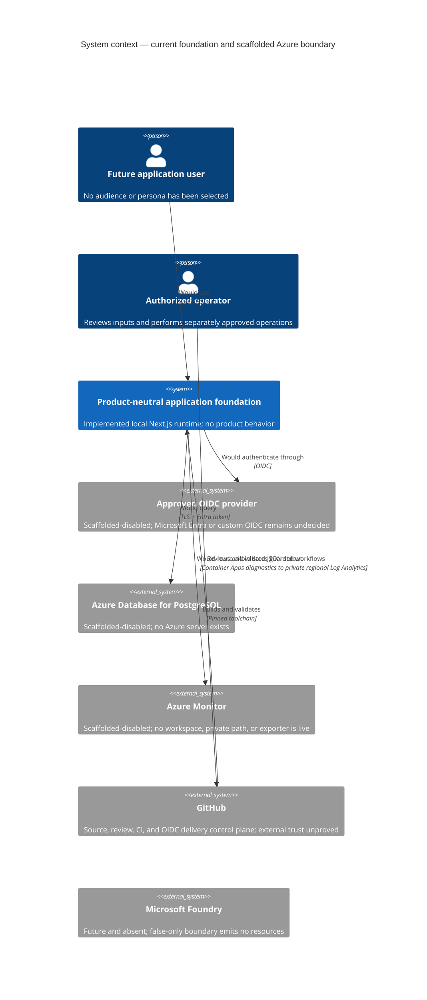
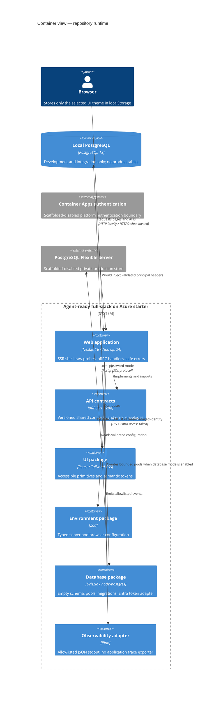

# Architecture

This document is the living source of truth for system shape. The
[repository constitution](CONSTITUTION.md) is binding when this document and governance differ.

> **Not yet production configured.** No Azure resource has been provisioned or verified by this
> repository. The Azure templates are offline-validated scaffolding, checked-in production inputs
> are intentionally incomplete, and no data-residency claim is made.

## Status vocabulary

Every material surface uses one of these labels:

- **Implemented** — executable and tested in this repository. This does not imply cloud deployment.
- **Scaffolded-disabled** — represented by code or infrastructure, but disabled, incomplete, or
  blocked from production use.
- **Future** — not implemented; admission requires a governed specification and the rules below.

Plans and diagrams do not promote a surface to implemented.

## System inventory

| Surface                                | Status                  | Current truth                                                                                                                                                                                                                   |
| -------------------------------------- | ----------------------- | ------------------------------------------------------------------------------------------------------------------------------------------------------------------------------------------------------------------------------- |
| pnpm/Turborepo workspace               | **Implemented**         | One Next.js app and six consumed shared packages use explicit workspace exports.                                                                                                                                                |
| Neutral web shell                      | **Implemented**         | Next.js App Router renders an accessible light/dark foundation page with no product behavior. Theme changes have no color animation, and browser tests recheck contrast after each switch.                                      |
| HTTP foundation                        | **Implemented**         | Raw liveness/readiness probes and an oRPC v1 health contract, handler, and typed client exist.                                                                                                                                  |
| Runtime authentication parsing         | **Implemented**         | A server-only parser validates the Container Apps principal header. No route currently consumes it for authorization.                                                                                                           |
| Product authorization                  | **Future**              | There are no roles, permissions, product actions, or authorization policy. New behavior must deny by default.                                                                                                                   |
| PostgreSQL package                     | **Implemented**         | The empty Drizzle boundary includes local migration, a `pg` pool, refreshable Entra tokens, and a bundled production migration entrypoint with a same-session advisory lock. No product tables exist.                           |
| Local PostgreSQL and browser tests     | **Implemented**         | Compose PostgreSQL, real-pool/migration integration tests, and Playwright/axe foundation tests are separate environment-dependent checks. See [Local development](#local-development).                                          |
| Standalone container image             | **Implemented**         | A digest-pinned Node 24 root-context build emits a non-root standalone runtime and includes `migration/dist/migrate-production.mjs` plus migration files. It has not been deployed.                                             |
| Deterministic CI workflows             | **Implemented**         | SHA-pinned workflows define quality/build, dependency audit, Docker, PostgreSQL integration, Playwright/axe, offline IaC, and CodeQL jobs. No hosted run evidence exists in this bootstrap.                                     |
| Azure plan/delivery workflow code      | **Implemented**         | Manual definitions validate source/config/image evidence, create same-run staged what-if reviews, separate four OIDC duties, migrate before traffic, and verify rollback. No run or external trust/RBAC/runner evidence exists. |
| Structured runtime logging             | **Implemented**         | Pino emits PII-safe allowlisted JSON stdout. The prohibited Vercel instrumentation dependency and every application trace exporter are absent.                                                                                  |
| Azure workload topology                | **Scaffolded-disabled** | GA-schema Bicep models a regional private topology and explicit foundation, migration, and application stages. It has compiled offline only; production preflight rejects checked-in inputs.                                    |
| Container Apps built-in authentication | **Scaffolded-disabled** | Bicep supports Microsoft Entra or custom OIDC, but issuer, audience, tenant, client, callback, and allowlists are unresolved.                                                                                                   |
| Azure PostgreSQL                       | **Scaffolded-disabled** | Flexible Server, private networking, Entra authentication, and backup/HA parameters are modeled only. Database principals and grants cannot be created by ARM.                                                                  |
| Azure Monitor routing                  | **Scaffolded-disabled** | Container Apps JSON stdout and approved diagnostics target regional private Log Analytics. Application Insights/AMPLS are modeled but have no connection string, DCE/DCR, runtime exporter, or live export.                     |
| Azure deployment state                 | **Future**              | No resource or workflow run is evidenced. Protected environments, federated credentials, least-privilege RBAC, private runners, production values, bootstrap, and approvals remain external gates.                              |
| Foundry boundary                       | **Scaffolded-disabled** | `enableFoundry` is false-only and nondeployable. The boundary declares zero resources, DNS, RBAC, data-plane requirements, models, or agents; preflight rejects any request to enable it.                                       |
| Additional services or apps            | **Future**              | `services/` remains `.gitkeep`-only and there is one web app.                                                                                                                                                                   |

## Project structure

```text
.
├── .copilot/
│   └── skills/                   # Repository-local agent skills
├── .github/
│   ├── workflows/                # Deterministic CI and guarded manual Azure surfaces
│   ├── instructions/             # Path-specific implementation guidance
│   └── prompts/                  # Reusable planning/review prompts
├── apps/
│   └── web/                     # Next.js composition, routes, handlers, runtime wiring
├── packages/
│   ├── api-contracts/           # oRPC v1/Zod request, response, status, and error contracts
│   ├── db/                      # Drizzle boundary, migrations, pg pool, Entra token adapter
│   ├── env/                     # Only environment parsing boundary
│   ├── eslint-config/           # Shared flat ESLint configuration
│   ├── typescript-config/       # Shared strict TypeScript configuration
│   └── ui/                      # Shared primitives and executable semantic tokens
├── services/
│   └── .gitkeep                 # Reserved; no service exists
├── infra/
│   ├── environments/            # Synthetic compile and intentionally incomplete production inputs
│   ├── modules/                 # Modular regional Azure topology
│   ├── scripts/                 # Offline Bicep validation and fail-closed preflight
│   └── tests/                   # Preflight allow/deny coverage
├── docs/
│   ├── adr/                     # Architecture decisions and template
│   ├── architecture/            # Capability-readiness records
│   ├── runbooks/                # Identity, database, and deployment procedures
│   └── security/                # Classification, residency, threat, and telemetry records
├── specs/
│   ├── PRDs/                    # Empty product specification catalog at bootstrap
│   ├── design/                  # Product-neutral design contract
│   └── templates/               # Governed PRD template
├── ARCHITECTURE.md              # This source of truth
├── CONSTITUTION.md              # Binding repository governance
├── Dockerfile                   # Root-context standalone, non-root application image
├── compose.yaml                 # Local PostgreSQL only
└── azure.yaml                   # azd infrastructure hook; no application service declaration
```

Workspace imports cross package boundaries only through `@repo/*` exports. Source-relative
cross-package imports and root TypeScript aliases are not architecture boundaries.

## C4 context



## C4 containers



## C4 deployment

The Azure nodes below are **scaffolded-disabled**, not deployed resources.

```mermaid
C4Deployment
  title Deployment view — offline-compiled target topology, not an Azure deployment

  Deployment_Node(internet, "Public network", "Untrusted") {
    Deployment_Node(client, "Client", "Browser")
  }

  Deployment_Node(azure, "One explicitly approved Azure region", "Region unresolved") {
    Deployment_Node(vnet, "Virtual network", "Address space must pass preflight") {
      Deployment_Node(appgwsubnet, "Application Gateway subnet", "Dedicated /24 or larger") {
        Container(appgw, "Application Gateway WAF v2", "Regional HTTPS ingress and header rewrite")
      }
      Deployment_Node(casubnet, "Container Apps subnet", "Delegated /23 or larger") {
        Container(caenv, "Internal Container Apps environment", "Private environment, encrypted peer traffic")
        Container(webapp, "Web app", "Multiple-revision staging; candidate receives no serving traffic before acceptance")
        Container(job, "Migration job", "Manual, private, bundled entrypoint, distinct managed identity")
      }
      Deployment_Node(pesubnet, "Private endpoint subnet", "Dedicated") {
        Container(pe, "Private endpoints", "ACR, Key Vault, PostgreSQL, AMPLS")
      }
      Deployment_Node(firewallsubnet, "Reserved Azure Firewall subnet", "Disabled in compile fixture; required by production preflight")
    }

    ContainerDb(pg, "PostgreSQL Flexible Server", "Private endpoint, Entra-only authentication")
    Container(acr, "Azure Container Registry", "Private, admin disabled")
    Container(kv, "Key Vault", "Private, RBAC, purge protection")
    Container(logs, "Log Analytics", "Regional target for approved JSON stdout and platform diagnostics")
    Container(monitor, "Application Insights component", "Scaffolded-disabled; no application connection string or trace export")
  }

  Deployment_Node(nonregional, "Nonregional control planes", "Separate approval required") {
    Container(entra, "Microsoft Entra", "OIDC and workload identities")
    Container(arm, "Azure Resource Manager", "Provisioning and deployment history")
    Container(dns, "DNS/private DNS", "Global control-plane records")
    Container(gh, "GitHub", "Source, Actions, four separately scoped OIDC duties")
    Container(ampls, "Azure Monitor Private Link Scope", "Global control plane; regional endpoint; no live path")
  }

  Rel(client, appgw, "HTTPS")
  Rel(appgw, webapp, "HTTPS to internal FQDN")
  Rel(webapp, pg, "TLS + Entra token through private endpoint")
  Rel(job, pg, "Forward-only migrations under a same-session advisory lock")
  Rel(webapp, acr, "Pulls image with managed identity")
  Rel(webapp, kv, "Reads approved secrets with managed identity")
  Rel(caenv, logs, "Would route approved JSON console/system diagnostics", "Azure Monitor diagnostic settings")
  Rel(logs, ampls, "Would scope private ingestion/query", "No live path")
  Rel(gh, arm, "Guarded manual what-if, registry, infrastructure, and rollout duties", "Distinct short-lived OIDC identities")
  Rel(entra, webapp, "OIDC validation and managed-identity tokens")
```

## Runtime request flow

### Implemented local flow

1. A client reaches the Next.js Node.js process directly.
2. Next.js applies enforced transport/browser headers and a report-only Content Security Policy.
3. `/health/live` returns process liveness only. It does not read configuration or contact a store.
4. `/health/ready` parses the server environment. It returns `not_ready` for invalid configuration;
   with database mode `disabled` it returns `ready`; otherwise it reuses a process-local,
   single-connection `pg` readiness pool and token provider, runs a probe-bounded `select 1`, and
   reports only readiness. Connection/query failure discards the pool so the next probe reconnects;
   cold connection/token acquisition has a separate 10-second budget.
5. `/api/v1/*` enters the oRPC OpenAPI Fetch dispatcher. The versioned contract validates output;
   the wrapper normalizes unsupported methods, validation failures, missing routes, and unexpected
   failures to allowlisted envelopes.
6. A valid UUID request correlation ID is retained; any other value is replaced. Responses disable
   caching and include the opaque ID.
7. The logger records only the event and allowlisted operational fields. It does not receive request
   or response bodies.

The current health procedure is the only first-party JSON contract. Future first-party JSON APIs use
oRPC v1. A raw JSON route is permitted only for a protocol need recorded in an ADR.

### Scaffolded Azure flow

1. Public DNS would resolve the approved host to a regional Application Gateway public IP.
2. Application Gateway would terminate public TLS, enforce WAF prevention rules, and establish HTTPS
   with certificate/SNI validation to the internal Container App FQDN.
3. The gateway rewrite set would overwrite `X-Forwarded-Host` and `X-Forwarded-Proto` with the
   approved public origin and clear inbound `X-MS-CLIENT-PRINCIPAL*` headers.
4. The internal Container Apps environment and app IP restriction would accept app ingress only from
   the gateway subnet.
5. Container Apps built-in authentication would validate the configured provider, redirect
   unauthenticated requests, and inject its principal header. Liveness and readiness are excluded
   from authentication.
6. Application code would normalize that header. No current product handler performs authorization;
   a future handler must map the normalized identity to PRD-defined policy and deny by default.

This trust chain is safe only after the public host, forwarded-origin behavior, callback/logout
paths, provider metadata, direct-ingress restriction, and header overwrite behavior are manually
verified. See the [identity bootstrap runbook](docs/runbooks/identity-bootstrap.md).

## Trust boundaries

| Boundary                          | Input                             | Owner and required behavior                                                                                                       | Status                                                                 |
| --------------------------------- | --------------------------------- | --------------------------------------------------------------------------------------------------------------------------------- | ---------------------------------------------------------------------- |
| Internet → Application Gateway    | TLS, host, method, headers, body  | Gateway owns public TLS, WAF, size limits, and forwarded/header rewrite.                                                          | **Scaffolded-disabled**                                                |
| Gateway → Container Apps ingress  | Re-encrypted HTTP request         | Private network and IP restriction own reachability; backend certificate and SNI must validate.                                   | **Scaffolded-disabled**                                                |
| Container Apps auth → application | `X-MS-CLIENT-PRINCIPAL`           | Platform owns token authentication; application validates normalized shape and owns all authorization.                            | Parser **implemented**; platform **scaffolded-disabled**               |
| HTTP → oRPC handler               | Route, method, contract data      | Zod/oRPC validate external data; handler returns allowlisted errors and never trusts client-side authorization.                   | **Implemented** for health only                                        |
| Runtime → environment             | Process environment               | `@repo/env` is the only parser; invalid required configuration fails readiness.                                                   | **Implemented**                                                        |
| Runtime/job → PostgreSQL          | Queries and Entra token/password  | `@repo/db` owns pools and credentials; production requires `azure-managed-identity`; migration owns one advisory-locked session.  | Adapter/job bundle **implemented**; Azure path **scaffolded-disabled** |
| Runtime → telemetry               | Event plus fields                 | Logger strips unknown fields and prohibits sensitive content; approved JSON stdout would route to regional private Log Analytics. | Logger **implemented**; Azure route **scaffolded-disabled**            |
| Delivery identities → Azure       | OIDC tokens and reviewed evidence | Four workflow duties are separated; protected environment, FICs, Azure RBAC, and private runner must exist externally.            | Workflow **implemented**; external controls **future**                 |
| Future app → Foundry              | Prompts, files, tools, state      | No flow or infrastructure is admitted. A PRD and every readiness gate must pass before a new deployable design is created.        | **Future**                                                             |

Trust is not inferred from a header name, private IP, successful compile, or Azure resource ID.

## Authentication and authorization

### Authentication

- **Implemented:** strict decoding and normalization of one Container Apps principal header into
  authentication type, HTTPS issuer, subject, and name identifier. Absent and malformed states are
  explicit.
- **Scaffolded-disabled:** Container Apps built-in authentication for either tenant-specific
  Microsoft Entra or a custom OIDC provider. Token storage is disabled. A required client credential
  is represented as a versioned Key Vault reference, not a plain setting.
- **Unresolved:** workforce Entra versus Entra External ID/custom OIDC, audience, tenant, client,
  issuer, user admission policy, callback/logout URLs, and the public domain.

### Authorization

The application, not Container Apps, owns authorization. The repository defines no application
roles, permissions, user table, or policy engine. Authentication success is therefore not permission
to perform a future action. Each product contract must name the authorization decision, validate it
server-side, and deny absent, malformed, unrecognized, or insufficient principals. UI visibility is
not enforcement.

Managed identity authenticates workloads to Azure services; Azure RBAC and PostgreSQL grants
authorize those workloads. The application and migration identities remain distinct.

## State and stores

| Store/state                       | Status                                                  | Contents and assumptions                                                                                                               |
| --------------------------------- | ------------------------------------------------------- | -------------------------------------------------------------------------------------------------------------------------------------- |
| Browser `localStorage`            | **Implemented**                                         | `ui-theme` only (`light`, `dark`, or `system`). It is not an identity or security store.                                               |
| Next.js process memory/filesystem | **Implemented, ephemeral**                              | No application session or durable state. Replicas are interchangeable; no ISR or cross-replica cache contract exists.                  |
| Local PostgreSQL                  | **Implemented for development when Compose is running** | Empty Drizzle schema plus migration metadata only. Credentials are explicitly local.                                                   |
| Azure PostgreSQL Flexible Server  | **Scaffolded-disabled**                                 | Intended authoritative relational store. No server, principal, grant, schema, replica, or backup policy has been deployed or verified. |
| Container Apps auth token store   | **Scaffolded-disabled and configured off**              | `tokenStore.enabled` is false in Bicep. Provider/browser cookies still require normal security review.                                 |
| Container image registry          | **Scaffolded-disabled**                                 | ACR would store images privately with admin and anonymous access disabled.                                                             |
| Key Vault                         | **Scaffolded-disabled**                                 | Intended to hold the OIDC client credential and gateway certificate. No secret or certificate exists.                                  |
| Log Analytics                     | **Scaffolded-disabled**                                 | Intended regional store for approved Container Apps JSON stdout/platform categories with explicit retention and private query access.  |
| Application Insights/AMPLS        | **Scaffolded-disabled**                                 | Network/component scaffolding only. No connection string, DCE/DCR, application exporter, or live application telemetry flow exists.    |
| Foundry stores/state              | **Future and absent**                                   | The false-only boundary declares no account, project, capability host, store, DNS, RBAC, model, or agent.                              |

No product/customer record is defined. Unclassified future customer data is Restricted.

## Regional network topology

The conservative target is one explicitly approved Azure region:

- A dedicated regional Application Gateway WAF v2 subnet is the only public request-processing edge.
  Azure Front Door is absent.
- A workload-profile Container Apps environment is internal, has public network access disabled, and
  uses a delegated subnet. The app ingress is externally addressable only inside that environment
  and restricted to the Application Gateway subnet.
- A dedicated private-endpoint subnet serves ACR, Key Vault, PostgreSQL, and AMPLS. Corresponding
  private DNS zones and VNet links are modeled.
- A separate Azure Firewall subnet is reserved without adding a Foundry subnet or requirement.
- Azure Firewall is disabled in the compile fixture. Restricted production preflight requires the
  implemented firewall mode, forced routes, a nonempty FQDN allowlist, and explicit outbound-control
  approval.
- Container Apps peer mTLS and peer traffic encryption are modeled. Application Gateway re-encrypts
  to the Container App FQDN and validates certificate chain, expiry, and SNI.
- PostgreSQL geo-backup and replicas are empty/disabled in the fixture. Any secondary region
  requires explicit location and approval.

Private DNS zones and AMPLS include global control-plane resources; Entra, Azure Resource Manager,
GitHub, public DNS, certificate authorities, and package registries are also nonregional or
multiregional dependencies. Private data planes do not create a blanket residency guarantee. The
[residency matrix](docs/security/DATA_RESIDENCY.md) is authoritative for these qualifications.

## Deployment and migration

### What exists

- `infra/main.bicep` is a subscription-scope entry point that creates an environment resource group
  and invokes regional modules with explicit `foundation`, `migration`, and `application` stages.
- `infra/environments/compile.config.json` contains synthetic, nonproduction values only.
- `infra/environments/production.config.json` is intentionally incomplete and production preflight
  rejects synthetic markers, placeholder domains, low-entropy UUIDs/SHAs, test/example values,
  unresolved monitoring posture, public data planes, and Foundry enablement.
- `infra/scripts/preflight.mjs` deterministically rejects unresolved production region, identity,
  DNS/TLS, SKU, diagnostics, network, egress, private-runner, backup/replica, monitoring, and
  Foundry decisions. Its monitoring result is machine-readable.
- `azure.yaml` runs preflight before provisioning and declares no application service.
- `.github/workflows/infra-plan.yml` performs tokenless source/config validation, then produces
  sanitized digest-bound what-if evidence on a protected VNet-connected runner. It never deploys.
- `.github/workflows/deploy.yml` implements the staged contract below. It builds and accepts the
  release without cloud credentials, uses a protected VNet-connected runner for every Azure job, and
  requires exact deployment, migration, and configuration-digest confirmations.
- Offline validation formats, lints, and compiles Bicep and exercises preflight; it never authorizes
  provisioning.

### Implemented staged delivery contract

The checked-in workflow definition separates and binds these stages in one run:

1. **Tokenless acceptance:** validate the default-branch commit, complete quality/unit/spec/IaC,
   PostgreSQL integration, browser/accessibility, and image smoke checks; run production preflight;
   compile Bicep; and seal source/config/template/image evidence.
2. **Foundation plan and gate:** the dedicated what-if identity produces a sanitized review
   artifact. Required reviewers inspect that same-run artifact before the infrastructure identity
   rematerializes identical parameters, reruns what-if, and requires the canonical Azure state
   digest to match before creating only prerequisites.
3. **Registry publication:** the separately scoped registry identity pushes the reviewed image
   through private ACR, proves the manifest digest resolves to the local image, and
   write/delete-locks both commit-SHA tag and digest. The tag binds provenance; every deployment
   parameter and runtime check uses `${registry}/${repository}@sha256:…`, never the tag.
4. **Migration plan, deployment, and execution:** another same-run reviewed/fresh what-if pair
   creates only the digest-pinned migration job. The migration/runtime identity verifies its
   command, environment, managed identity, digest, and absence of password/exporter settings, starts
   exactly one execution, waits for `Succeeded`, and seals evidence.
5. **Application plan and inactive candidate:** only successful migration evidence admits the
   application what-if/deployment. Existing service keeps one prior revision at 100% and the new
   candidate at 0%; first bootstrap remains externally disabled with a deny-all restriction until
   acceptance.
6. **Activation and verification:** the migration/runtime identity verifies candidate health, exact
   digest, disabled application-export mode, built-in-auth configuration, prior service posture,
   forged-header rejection, public probes, direct-backend denial, and the safe
   `telemetry.initialized` JSON event in Log Analytics before accepting the candidate at 100%.
7. **Verified rollback:** any acceptance failure restores the exact prior traffic and ingress
   posture, deactivates the failed candidate when a prior revision exists, and rechecks traffic,
   exposure, health, and authentication. First-bootstrap failure restores deny-all/unreachable
   ingress. A failure whose recovery cannot be proved demands immediate operator action.

Foundation, migration, and application what-if artifacts are sanitized, digest-bound, retained for
review, and verified again against fresh Azure state before each mutation. This is same-workflow-run
evidence; it is not a claim that a run, review, or Azure environment exists.

Four distinct client IDs are enforced for **what-if**, **registry push**, **infrastructure
deployment**, and **migration/runtime rollout plus monitoring query**. Their GitHub protected
environment, exact federated identity credentials, least-privilege Azure management/data-plane RBAC,
runner location/isolation/patching, and private DNS/network reachability are deliberately external
controls and remain production blockers.

Certificate/secret provisioning, PostgreSQL Entra principal/grant bootstrap, provider/quota/policy
readiness, production monitoring approval, data residency, recovery objectives, and all actual
post-deployment evidence also remain external. The workflow must not be dispatched merely because
its repository-side sequence is implemented. See the
[deployment runbook](docs/runbooks/deployment.md).

### Migration contract

Migrations never run during package install, Next.js build, image build, or application startup.
Production execution belongs to the manual Container Apps Job with its own managed identity.

`packages/db/src/migrate-production.ts` is bundled at build time to
`packages/db/dist/migrate-production.mjs`; the image copies that file and migrations under
`/app/migration`, and the job runs `node migration/dist/migrate-production.mjs`. It accepts only
`RUNTIME_MODE=production` with `DATABASE_MODE=azure-managed-identity`. It uses a dedicated max-one
migration pool with a 30-second connection budget, refreshable managed-identity password callback,
and certificate-verifying TLS. The readiness query timeout is not a migration query or statement
timeout. The entrypoint obtains one `PoolClient`, uses `pg_try_advisory_lock` on that PostgreSQL
session, runs Drizzle through the same client, unlocks in `finally`, releases the client, and closes
the pool. Lock contention and every configuration/migration error fail closed with bounded,
nonsensitive output.

Every persistence PRD uses expand/migrate/contract:

1. **Expand:** add backward-compatible structures while old and new application revisions coexist.
2. **Migrate:** backfill in bounded, observable, restartable steps; validate counts and invariants.
3. **Switch:** deploy code that can use the new shape while compatibility remains.
4. **Contract:** remove old structures only in a later reviewed change after rollback windows close.

Application rollback is allowed only while the database remains backward compatible. Destructive
database rollback is not assumed; restore or repair is a separately approved recovery operation.

See the [deployment](docs/runbooks/deployment.md) and
[database bootstrap](docs/runbooks/database-bootstrap.md) runbooks.

## Observability and CSP

### Implemented boundary

- Structured events use a fixed event-name enum and a fixed field schema.
- Allowed fields are opaque correlation/trace/span IDs, bounded duration/status, outcome, component,
  and a few boolean/enumerated states.
- Unknown fields are stripped; sensitive field names are additionally redacted by Pino.
- Exceptions, headers, URLs, query strings, bodies, tokens, cookies, uploads, prompts, completions,
  and unrestricted text are not logged.
- The prohibited Vercel instrumentation package is removed. JSON stdout is the only implemented
  application observability emission path.
- Production uses `TELEMETRY_MODE=disabled`; the reserved Azure Monitor exporter mode fails closed
  because stable `@azure/monitor-opentelemetry@1.18.2` resolves a beta exporter and its required ESM
  `--import` loader is incompatible with the standalone Next.js entrypoint.

The target Container Apps environment uses Azure Monitor log routing so PII-safe JSON stdout and
approved platform categories can reach an explicitly reviewed regional private Log Analytics
workspace. Workspace retention, categories, query RBAC, AMPLS DNS/private path, and the monitoring
exception are approval-gated and **scaffolded-disabled**, not active controls. Application Insights
and AMPLS are modeled without an application connection string, DCE, DCR, or trace exporter; no live
application export is claimed. Production preflight requires the explicit reviewed posture. See
[Logging and telemetry](docs/security/LOGGING_AND_TELEMETRY.md).

### Content Security Policy strategy

The current Next.js configuration enforces HSTS, COOP, CORP, Permissions Policy, Referrer Policy,
content-type protection, and frame denial. CSP is **report-only** and currently permits
`'unsafe-inline'` for scripts and styles to avoid breaking streamed App Router output. No CSP report
collector is configured, so reporting is not yet operational.

Before CSP enforcement:

1. inventory required sources without adding broad wildcards;
2. implement per-request nonces compatible with Next.js streaming and remove script
   `'unsafe-inline'`;
3. minimize or replace style `'unsafe-inline'`;
4. add a rate-limited report endpoint whose schema discards full document/blocked URLs, query
   strings, samples, cookies, and free text;
5. validate report-only violations in every rendered route;
6. promote the reviewed policy to `Content-Security-Policy` and retain a safe rollback path.

Any new external script, style, image, frame, form, or connection origin is an architecture,
security, and residency change.

## Local development

The local boundary is intentionally simpler than Azure:

- Next.js runs directly on the developer host.
- PostgreSQL is the only Compose service.
- Local password authentication is allowed only with explicit `RUNTIME_MODE=local` and
  `DATABASE_MODE=local-password`.
- The home page requires no Azure credential. `DefaultAzureCredential` is available only through the
  explicit local Azure database mode; hosted mode uses `ManagedIdentityCredential`.
- Authentication may be disabled locally. There is no production-capable development bypass and
  tests inject principal fixtures directly.
- Unit checks are deterministic. PostgreSQL integration, Playwright, and Docker checks remain
  separately invoked.
- ESLint `9.39.5` is intentionally the newest stable line compatible with the workspace peer ranges;
  ESLint 10 is not an unresolved upgrade failure. shadcn-generated configuration/components remain
  as source, but the unused CLI dependency is omitted so the lockfile resolves no semver prerelease.

Use the exact commands and current environment values in the [README](README.md).

## Failure and recovery assumptions

| Failure                                   | Expected behavior                                                                                 | Recovery boundary                                                                                                            |
| ----------------------------------------- | ------------------------------------------------------------------------------------------------- | ---------------------------------------------------------------------------------------------------------------------------- |
| Invalid runtime configuration             | Readiness is `503 not_ready`; instrumentation does not initialize.                                | Correct reviewed configuration and replace the revision. Do not silently default production values.                          |
| Database unavailable/token refresh fails  | Readiness fails, discards its pool, and exposes no database detail to the client.                 | Restore private connectivity/identity/grants; the next probe creates a pool/token provider and reconnects.                   |
| One web replica fails                     | Liveness removes the replica; no session affinity or in-memory state is required.                 | Container Apps replaces it. Production minimum replicas/zone behavior remains unverified until deployed.                     |
| Application Gateway backend probe fails   | Gateway should stop routing to the unhealthy backend.                                             | Investigate readiness, TLS/SNI, private DNS, and app ingress; do not bypass WAF to restore service.                          |
| OIDC provider/configuration fails         | Authentication fails closed or redirects fail.                                                    | Restore approved issuer/client/callback configuration from IaC and Key Vault; never accept raw identity headers as fallback. |
| ACR/private DNS unavailable               | New revisions cannot pull; running replicas may continue.                                         | Restore private DNS/data plane and use a previously verified immutable image.                                                |
| Migration lock is held or migration fails | The same-session advisory lock/configuration/job fails closed; application planning cannot begin. | Diagnose from redacted evidence, repair forward, or restore through a separately approved database recovery plan.            |
| Candidate or acceptance check fails       | Prior traffic remains serving until activation; post-shift failure invokes rollback.              | Prove restored traffic/exposure and prior health/auth, or escalate immediately. First bootstrap returns to deny-all ingress. |
| Regional outage                           | No multi-region failover exists.                                                                  | Follow the approved service recovery decision when residency geography is known; do not improvise cross-region replication.  |
| Telemetry unavailable                     | Application behavior must not depend on telemetry success.                                        | Restore the approved private path; investigate with minimal platform evidence, not sensitive debug logging.                  |
| Foundry dependency failure                | No current effect because no Foundry dependency or resource exists.                               | Future recovery belongs to the admitting PRD and a new deployable design.                                                    |

Recovery time objectives, recovery point objectives, on-call ownership, and regional disaster
recovery are unresolved production decisions.

## Architecture update rules

In the same change, update this document when a component, package boundary, contract style, store,
trust boundary, identity responsibility, integration, network path, deployment surface,
observability destination, or failure/recovery assumption changes.

Also update:

- the relevant ADR for a durable decision or reversal;
- `specs/design/DESIGN.md` and executable tokens for design-system changes;
- the threat model and residency matrix for sensitive data-flow changes;
- Drizzle schema and generated migration for persistence changes;
- operator runbooks when a bootstrap, deployment, or recovery step changes.

Status labels follow evidence: code plus local tests can be implemented; compiled but disabled IaC
is scaffolded-disabled; intention alone is future. Never use documentation to imply Azure
deployment, residency approval, or a working control.

## Future-service admission

A new app, package, service, store, queue, cache, external API, analytics tool, or Foundry behavior
is admitted only when all applicable items are present:

1. A same-change active/current cataloged PRD precedes implementation and names scope, exclusions,
   classifications, affected files, impacts, and evidence. Validation fails closed for functional
   source, manifest, lockfile, configuration, style, IaC, workflow, Copilot, deletion, rename, and
   unknown-path changes; only narrow documentation/harmless-metadata cases are exempt.
2. Existing platform/package options were considered; the new boundary has an immediate consumer and
   named owner.
3. Contracts, authorization, data minimization, retention/deletion, and failure behavior are
   explicit.
4. Every regional and nonregional processing, storage, telemetry, backup, support, and control-plane
   path is recorded and approved.
5. Network ingress/egress, identity, secrets, least-privilege access, and supply-chain delivery are
   designed fail-closed.
6. Architecture, ADR, design, threat, residency, migration, and runbook impacts change together.
7. Deterministic tests and environment-dependent evidence map to every acceptance criterion.
8. Production inputs remain blocked until separately reviewed preflight, what-if, bootstrap, and
   operational readiness complete.

Foundry additionally follows the [Foundry readiness gate](docs/architecture/FOUNDRY_READINESS.md).
`services/` remains empty until an admitted service actually exists.

## Decisions

- [ADR-0001: Platform foundation](docs/adr/0001-platform-foundation.md)
- [ADR template](docs/adr/ADR_TEMPLATE.md)
