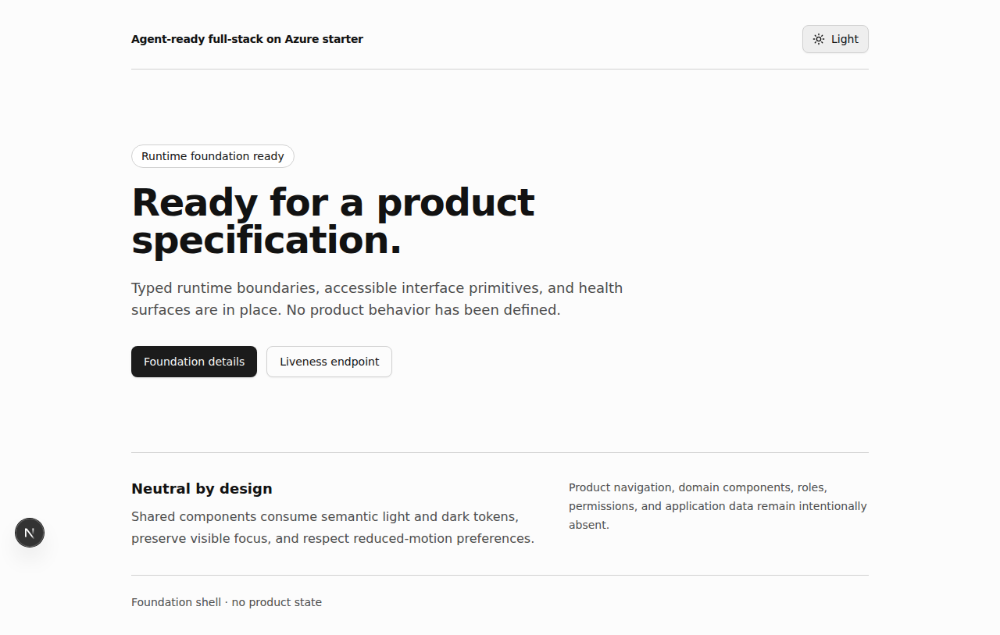
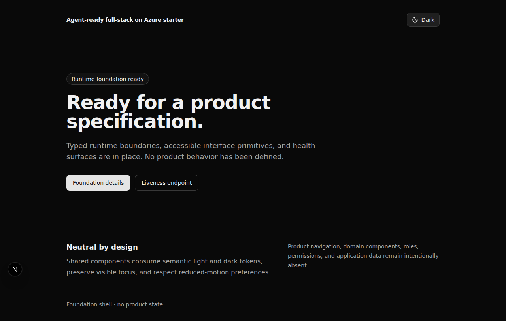
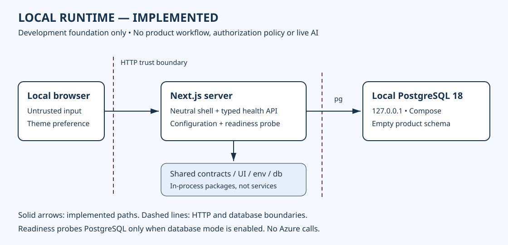
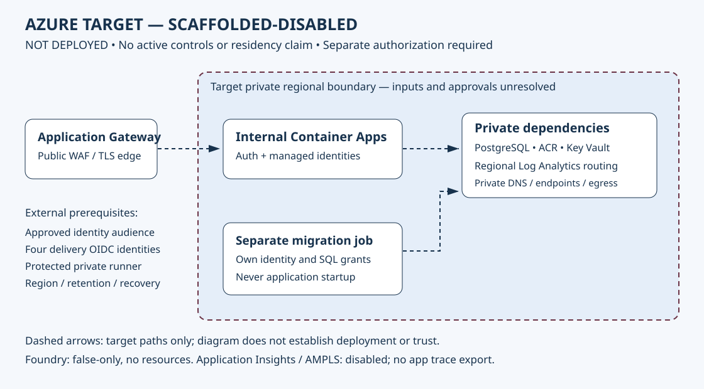

```text
               GOVERNED APPLICATION FOUNDATION

   +-----------------+      +--------------------------+
   | Request + PRD   | ---> | Next.js / typed API / UI |
   +-----------------+      +------------+-------------+
                                         |
                              +----------v-----------+
                              | Local PostgreSQL     |
                              | No product tables    |
                              +----------------------+

                  .---------------------------.
               .-'       AZURE TARGET          '-.
              (    IaC + guarded delivery         )
               '---------------------------------'
                   SCAFFOLDED / NOT DEPLOYED
```

# Agent-ready Full-stack on Azure Starter

**A reusable foundation for platform teams starting governed applications—not a finished product or
live AI agent.**

Establish a consistent local starting point, inspect typed application boundaries, and identify the
decisions required before Azure deployment.

> **WARNING — NOT YET PRODUCTION CONFIGURED.** No Azure resource has been provisioned and no
> delivery workflow run is evidenced. Production regions, identity audience, DNS/TLS, SKUs, egress,
> monitoring posture, PostgreSQL principal bootstrap, private-runner controls, residency approvals,
> and recovery objectives are unresolved. Offline-valid Bicep and checked-in workflows are not
> deployment readiness.

> **SCOPE —** “Agent-ready” means architecture readiness for future agent work; no model or agent is
> included. Foundry is false-only and nondeployable, and Application Insights export is disabled.

This repository is a lean, production-shaped foundation for a future application. It has one
runnable Next.js TypeScript app, shared oRPC v1 contracts, accessible semantic UI tokens, an empty
Drizzle/PostgreSQL boundary, local tests/container tooling, governed specifications, and
scaffolded-disabled Azure infrastructure. It defines no product behavior, brand, role, permission,
user model, or Foundry agent.

## Who this helps and why

Platform engineering teams are asked to help developers deliver applications while maintaining
consistent security, accessibility, and deployment practices. Teams often repeat foundational setup
and discover identity, networking, and operational decisions late in delivery. This starter provides
a reusable local application foundation with typed APIs, shared UI primitives, database tooling, and
specification-led change controls. It helps teams begin an informed platform conversation and leave
with a working local baseline and prioritized implementation backlog. It does not provide a customer
business workflow, live AI agent, or verified Azure environment.

**Primary persona:** platform engineer. **Secondary audiences:** developers, SEs, and CSAs.
**Customer scope:** reusable / cross-industry; no account or industry-specific requirements have
been provided. **Target:** catalog-ready; **current rating:** demo package prepared, readiness gates
open. This is not Microsoft Accelerator Catalog acceptance or production authorization.

### Start here

1. Review [capability status](#capability-status) and [prerequisites](#prerequisites).
2. Follow the [local quickstart](#local-quickstart).
3. Use the [presenter preflight](#presenter-preflight) and [five-minute demo](#five-minute-demo).
4. Review [adaptation](#adaptation-and-reusability) and
   [readiness gates](#repo-preparation-checklist).
5. Bring one application request to the [adoption workshop](#customer-engagement).

### Capability status

| Surface                        | Current scope                                                                                                                                                |
| ------------------------------ | ------------------------------------------------------------------------------------------------------------------------------------------------------------ |
| Implemented locally            | Neutral web shell; theme controls; liveness/readiness; oRPC health API; typed environment validation; database pools/migration tooling; empty product schema |
| Implemented repository tooling | Specification governance, existing tests, container build and guarded workflow definitions; definitions are not successful-run evidence                      |
| Scaffolded-disabled            | Azure topology, hosted authentication configuration, Azure monitoring integrations                                                                           |
| Not provided                   | Customer business workflow, roles/authorization policy, product data, live AI model/agent, verified Azure deployment                                         |

The [architecture inventory](ARCHITECTURE.md#system-inventory) is authoritative. See the
[verification record](docs/accelerator/verification.json) for dated results and limitations.

### Application request to implementation-ready foundation

1. **Request:** A platform owner asks how teams can start consistently without hiding production
   risks. Inputs are intended users, goals, and delivery constraints.
2. **Context:** Review identity, classification, geography, networking, operations, and
   accessibility. Record known requirements and unresolved decisions; do not enter customer data
   into the demo.
3. **Inspect:** Review the web, contracts, UI, environment, and database boundaries. Separate local
   implementation from disabled Azure infrastructure.
4. **Run:** Start the local foundation and PostgreSQL using the quickstart below.
5. **Verify:** Exercise theme switching and health surfaces, then retain the relevant existing
   validation results for the demonstrated commit.
6. **Scope:** Use the [PRD workflow](CONTRIBUTING.md#change-workflow) for the first customer
   capability, identifying acceptance criteria and architecture/security/data impacts before
   implementation.
7. **Act:** Agree on adoption or a separately authorized pilot with named owners and explicit
   blockers.

## Use this repository as a template

After enabling **Template repository** under the GitHub repository's **Settings > General**, select
**Use this template > Create a new repository** to copy the complete tracked foundation without its
Git history.

In each repository created from the template:

1. Replace this README's title and description with the new product context.
2. Review the production blockers and governance records before adding product behavior.
3. Follow the local quickstart below and create a governed PRD for each functional change.

## Prerequisites

- Node.js `24.18.0`
- Corepack `0.35.0`
- pnpm `11.17.0`
- Git
- Docker with Compose v2 for local PostgreSQL/integration/image checks
- Bicep `0.45.15` for offline infrastructure checks included in `pnpm check`. Install the official
  executable at the ignored `infra/.tools/bicep` path, which the existing preflight tests require,
  and set `BICEP_CLI` to that executable if another version is on `PATH`. No Azure login is needed.

## Local quickstart

From the repository root:

```sh
corepack enable
corepack prepare pnpm@11.17.0 --activate
pnpm install --frozen-lockfile

cat > apps/web/.env.local <<'EOF'
RUNTIME_MODE=local
DATABASE_MODE=local-password
AUTH_MODE=disabled
LOGGING_MODE=json
TELEMETRY_MODE=disabled
NEXT_PUBLIC_RUNTIME_MODE=local
DATABASE_HOST=127.0.0.1
DATABASE_PORT=5432
DATABASE_NAME=foundation_local
DATABASE_USER=foundation_local
DATABASE_PASSWORD=local-only-do-not-use-in-production
DATABASE_POOL_MAX=4
DATABASE_PROBE_TIMEOUT_MS=2000
EOF

docker compose up -d --wait
pnpm db:migrate:local
pnpm dev
```

Open <http://localhost:3000>. The local credential above is intentionally obvious, bound to the
Compose-only database on `127.0.0.1`, and must never be reused.

Available protocol surfaces:

- `GET /health/live` — process liveness only
- `GET /health/ready` — validated configuration and database connectivity when enabled
- `GET /api/v1/health` — oRPC v1 contract/handler pipeline

`DATABASE_PROBE_TIMEOUT_MS` bounds only the readiness `select 1`. Readiness reuses a dedicated
single-connection pool and token provider, gives a cold connection up to 10 seconds, and discards
the pool after a connection or query failure. Runtime queries do not inherit the probe timeout.
Local and production migrations use a separate max-one pool with a 30-second connection budget and
no blanket query or statement duration limit.

Stop the app with `Ctrl-C`, then stop PostgreSQL:

```sh
docker compose down
```

To remove the local PostgreSQL volume as well:

```sh
docker compose down --volumes
rm -f apps/web/.env.local
```

The home page can run without Azure credentials. Authentication is disabled only in explicit local
configuration; this is not a production bypass.

Production does not use these local values. Its exact database mode is
`DATABASE_MODE=azure-managed-identity`; the image contains `migration/dist/migrate-production.mjs`
for the protected, manually triggered migration job. Do not invoke that entrypoint locally or as
part of application startup.

## Validation

Fast deterministic pull-request checks:

```sh
pnpm check
```

Individual commands:

| Command                             | Purpose                                                  |
| ----------------------------------- | -------------------------------------------------------- |
| `pnpm dev`                          | Run persistent workspace development tasks               |
| `pnpm build`                        | Build packages and the standalone Next.js app            |
| `pnpm lint`                         | Run shared ESLint and hardcoded-color policy             |
| `pnpm deps:audit`                   | Reject ranges, lock drift, and resolved prereleases      |
| `pnpm typecheck`                    | Run strict TypeScript checks                             |
| `pnpm test` / `pnpm test:unit`      | Run deterministic unit/component tests                   |
| `pnpm format` / `pnpm format:check` | Write/check Prettier formatting                          |
| `pnpm spec:new -- <args>`           | Scaffold and catalog a governed PRD                      |
| `pnpm spec:validate`                | Validate the changed specification set                   |
| `pnpm spec:validate:all`            | Validate the full specification set                      |
| `pnpm db:generate`                  | Generate Drizzle migrations from the schema              |
| `pnpm db:migrate:local`             | Apply migrations to the explicit local database          |
| `pnpm db:check`                     | Check Drizzle migration consistency                      |
| `pnpm db:studio`                    | Open local Drizzle Studio                                |
| `pnpm infra:validate`               | Format/lint/compile Bicep and test preflight offline     |
| `pnpm docker:build`                 | Build the non-root standalone image from repository root |

Environment-dependent checks stay separate:

```sh
docker compose up -d --wait
pnpm db:migrate:local
pnpm test:integration

pnpm --filter @repo/web exec playwright install chromium
pnpm e2e
pnpm docker:build
```

`pnpm e2e` builds and starts the standalone app with the database disabled, then runs neutral smoke,
axe WCAG, and post-switch light/dark/system contrast checks. Theme colors change without a
transition so no animated intermediate can create a transient contrast failure. It makes no Azure or
external model call.

## Repository map

| Path                                                        | Owner                                                                      |
| ----------------------------------------------------------- | -------------------------------------------------------------------------- |
| [`apps/web`](apps/web/)                                     | Next.js routes, oRPC handlers/client, health, auth parsing, runtime wiring |
| [`packages/api-contracts`](packages/api-contracts/)         | Versioned oRPC v1/Zod contracts and safe envelopes                         |
| [`packages/db`](packages/db/)                               | Empty Drizzle schema, migrations, `pg` pools, Entra token adapter          |
| [`packages/env`](packages/env/)                             | Only environment parsing boundary                                          |
| [`packages/ui`](packages/ui/)                               | Shared primitives and executable semantic light/dark tokens                |
| [`packages/eslint-config`](packages/eslint-config/)         | Shared flat ESLint rules                                                   |
| [`packages/typescript-config`](packages/typescript-config/) | Shared strict TypeScript configurations                                    |
| [`services`](services/)                                     | Reserved; `.gitkeep` only until an approved PRD admits a service           |
| [`infra`](infra/)                                           | Offline-compiled Bicep, synthetic/incomplete inputs, fail-closed preflight |
| [`.github/workflows`](.github/workflows/)                   | Deterministic CI plus guarded, unexecuted Azure plan/deploy candidates     |
| [`.copilot/skills`](.copilot/skills/)                       | Repository-local agent skills                                              |
| [`specs`](specs/)                                           | Governed PRD catalog, templates/tooling, design contract                   |
| [`docs`](docs/)                                             | ADRs, security/residency records, readiness and operator runbooks          |
| [`Dockerfile`](Dockerfile)                                  | Root-context standalone non-root production-shaped image                   |
| [`compose.yaml`](compose.yaml)                              | Local-only PostgreSQL 18 service and persistent development volume         |

Workspace imports use explicit `@repo/*` package exports. First-party JSON APIs use stable **oRPC
v1.14.10**, not the superseded ts-rest direction or the oRPC v2 beta. ESLint `9.39.5` is the newest
stable peer-compatible line for this workspace; the incompatible ESLint 10 baseline was deliberately
not selected. shadcn-generated configuration and component patterns are retained without installing
the shadcn CLI. The dependency audit confirms zero resolved semantic-version prereleases. These are
resolved tooling choices, not open failures.

## Architecture and governance

- [Constitution](CONSTITUTION.md) — binding repository rules
- [Architecture](ARCHITECTURE.md) — implemented, scaffolded-disabled, and future system shape
- [Security](SECURITY.md) — security posture and canonical records
- [Design contract](specs/design/DESIGN.md) — semantic UI/accessibility contract
- [Contributing](CONTRIBUTING.md) — PRD-first workflow and commands
- [ADR-0001](docs/adr/0001-platform-foundation.md) — platform foundation decisions
- [Deployment runbook](docs/runbooks/deployment.md) — explicit production blockers and sequencing
- [Foundry readiness](docs/architecture/FOUNDRY_READINESS.md) — closed admission gate

The Azure target is a regional Application Gateway WAF in front of an internal Container Apps
environment, with private ACR, Key Vault, PostgreSQL Flexible Server, a separate migration job,
regional private Log Analytics routing, managed identities, private DNS/endpoints, and controlled
egress. Application Insights and AMPLS are scaffolded-disabled and no application connection string
or trace exporter is wired. Foundry is a false-only, nondeployable boundary that emits no resources,
DNS, RBAC, requirements, model, or agent. All Azure surfaces remain undeployed.

## Before product work

After the bootstrap merges, every functional change requires a same-change active/current cataloged
PRD. Validation fails closed for source, manifests, lockfiles, configuration, styles, IaC,
workflows, Copilot instructions/skills, unknown paths, deletions, and both sides of renames; only
narrowly recognized documentation and harmless metadata are exempt. Boundary changes update
architecture in the same change; design, sensitive-data, and persistence impacts update their
canonical artifacts. Unknown customer data is Restricted, and unresolved region/identity/retention
decisions fail closed.

Do not run `azd up`, dispatch the production workflow, provision Azure, enable Foundry, or use a
live model as part of ordinary setup or validation. The workflow definitions require four distinct
OIDC client identities, but their protected environment, federated credentials, Azure RBAC, and
isolated VNet-connected runner are external controls that this repository does not create or prove.

## Demo experience

### Presenter preflight

- Follow the quickstart on the exact pinned toolchain. Keep the app running in its own terminal.
- Use only local/synthetic content; no Azure credentials, customer data, or live model is required.
- Confirm `DATABASE_MODE=local-password` in your local configuration without displaying credentials.
- Run these requests from another terminal:

  ```sh
  curl --fail-with-body http://localhost:3000/health/live
  curl --fail-with-body http://localhost:3000/health/ready
  curl --fail-with-body http://localhost:3000/api/v1/health
  ```

- Expect HTTP 200 with `status: live`, `status: ready`, and `status: ok` / `apiVersion: v1`,
  respectively. Responses also contain generated correlation IDs.
- Readiness validates configuration and probes the database **only when enabled**. A 200 with
  `DATABASE_MODE=disabled` is not database-connectivity evidence; liveness and the API health route
  never establish database connectivity.
- Optionally demonstrate failure: `docker compose stop postgres`, request readiness and expect 503 /
  `status: not_ready`, while liveness remains 200. Restore with `docker compose up -d --wait` and
  retry readiness before presenting. Allow the configured connection/probe timeout.
- Open this README, both architecture diagrams, and the verification record before screen sharing.
  Disable notifications and avoid terminal output containing environment variables or identifiers.

### Five-minute demo

| Time      | Action and talk track                                                                                                                                         |
| --------- | ------------------------------------------------------------------------------------------------------------------------------------------------------------- |
| 0:00–0:45 | “Teams repeat foundation work and discover platform decisions late.” State local-only scope.                                                                  |
| 0:45–1:45 | Open the homepage. Cycle system → light → dark; tab through controls to show visible focus. No business workflow is claimed.                                  |
| 1:45–2:45 | Request the three health URLs. Explain enabled database mode and the difference between liveness, readiness, and API contract health.                         |
| 2:45–4:00 | Show local and Azure-target diagrams. Explain package boundaries and unresolved production gates.                                                             |
| 4:00–5:00 | Show the readiness checklist. “This gives your team a consistent starting point and exposes decisions still required before deployment.” Invite the workshop. |

### Fifteen-minute demo

| Time          | Action and useful outcome                                                                                                                     |
| ------------- | --------------------------------------------------------------------------------------------------------------------------------------------- |
| 0–2 minutes   | Confirm audience, pain, constraints, and success criteria.                                                                                    |
| 2–5 minutes   | Demonstrate the shell, themes, keyboard focus, and health surfaces.                                                                           |
| 5–8 minutes   | Trace the health contract → router → response; contrast this with configuration/database readiness. Optionally stop/restart local PostgreSQL. |
| 8–10 minutes  | Show the PRD generator instructions and dated verification record. Do not invent a product capability or claim an unrun check.                |
| 10–13 minutes | Review the Azure target and deployment blockers with the platform/security owners.                                                            |
| 13–15 minutes | Select one adoption scenario, assign decision owners, and agree the next engagement.                                                          |

### Demo assets and fallback





| Asset                                                       | Use                                                                                                    |
| ----------------------------------------------------------- | ------------------------------------------------------------------------------------------------------ |
| [Local runtime diagram](docs/accelerator/local-runtime.svg) | Implemented local paths and boundaries; not a deployment diagram                                       |
| [Azure target diagram](docs/accelerator/azure-target.svg)   | Disabled target topology, not active controls                                                          |
| [Verification record](docs/accelerator/verification.json)   | Commit, environment, database mode, checks, media provenance and open gates                            |
| [Captioned local recording](docs/accelerator/demo.html)     | Five-minute silent browser capture with English narrative captions; independent release review pending |

To play locally, keep the asset folder together and open `docs/accelerator/demo.html`. If the
browser blocks captions on local files, optionally use Python 3's standard-library server from the
repository root:

```sh
python3 -m http.server 3200 --bind 127.0.0.1 --directory docs/accelerator
```

Open <http://127.0.0.1:3200/demo.html>, expand the player, and enable English captions. This serves
only the static asset folder on loopback; stop it with `Ctrl-C`. Never serve the repository root or
ignored local configuration. The README remains the full text alternative.

**Recording recipe:** Record the five-minute script at 1280×720 or higher in a clean browser
profile. Include all three health requests, explicitly identify enabled database mode, and show both
diagrams and the workshop CTA. Add synchronized captions describing the narrative and important
visual actions. Review the whole recording for credentials, personal information, notifications, and
misleading claims; record its source commit, capture date, runtime mode, and review approval
alongside the media. Publish only after review; do not substitute a montage or silent static slide
for a runnable demo.

**Fallback:** If the runtime fails, use the checked-in screenshots, diagrams, and dated evidence.
Say “These are previously captured local assets, not a live run.” The script is also a text
alternative for the silent recording. Never call fallback images or database-disabled tests live
database evidence.

**Reset:** Stop the app, run `docker compose down`, and clear the site's theme preference/browser
data to restore system theme. The quickstart's volume-removal command is destructive to local
development data; use it only when that data can be discarded. Repeat preflight before the next
demo.

**Demo success:** Another SE/CSA reproduces setup without author help; endpoints match documented
outcomes; relevant existing checks pass for the demo commit; viewers understand current versus
disabled capabilities and can name the next action. Automated accessibility results do not replace
manual keyboard and assistive-technology review.

## Architecture at a glance





The browser is untrusted input to the web boundary. Shared packages are in-process boundaries, not
independently deployed services. Local PostgreSQL is loopback-bound; hosted private networking,
identity, monitoring, and recovery controls are not proved by these diagrams. See
[Architecture](ARCHITECTURE.md) for detailed C4 views and the
[deployment runbook](docs/runbooks/deployment.md) for authorization and prerequisites.

## Adaptation and reusability

| Reuse                                                           | Customize or qualify                                                                |
| --------------------------------------------------------------- | ----------------------------------------------------------------------------------- |
| Next.js workspace, typed contracts and explicit package exports | Define customer behavior through a cataloged PRD before coding                      |
| Semantic UI tokens and primitives                               | Specify branding, navigation, and domain views; none are supplied                   |
| Database pools and migration tooling                            | Define product schema, classification, lifecycle, recovery and generated migrations |
| Governance and validation patterns                              | Review fit with organizational standards rather than implying universal approval    |
| Bicep and guarded delivery patterns                             | Resolve customer inputs and external identity/network/operational controls          |
| Security and bootstrap runbooks                                 | Assign actual owners and obtain required approvals/evidence                         |

**Sample data: not required.** No product tables or business dataset exist. Do not invent seed data
for presentation polish. A later customer scenario needs a PRD and approved synthetic fixtures.

Before sharing a fork or assets, review source, configuration, logs, workflow artifacts,
screenshots, and recordings for customer names, internal URLs, production identifiers, personal
information, machine-specific paths, tokens, credentials, and connection strings. Follow
[Security](SECURITY.md) for private reporting; never put suspected secrets into public issues.

Reusable handoff materials are this presenter script, the discovery questions, diagrams, decision
worksheet, verification record, checklist, and provisional metadata. Customer answers and
environment values belong in an approved private workspace, not this public repository.

## Customer engagement

**Account-team opener:** “Are your teams repeatedly rebuilding application foundations and
discovering security or deployment decisions late? We can demonstrate a reusable local baseline and
help identify what your organization needs before adopting it.”

### Discovery questions

1. Who owns application foundations today?
2. Which setup or review steps repeatedly delay teams?
3. What existing platform standards must remain authoritative?
4. Which identity providers, user audiences, and authorization policies apply?
5. What data classifications and residency constraints apply?
6. Which private networking and deployment controls are mandatory?
7. Who will operate, support, and update applications created from the starter?
8. Is AI required? What task and measurable outcome justify it?

### Application Foundation Adoption Workshop

**Inputs:** One application scenario, the current delivery process, known constraints, and
platform/security owners.

**Activities:** Demonstrate locally, map reusable boundaries, identify gaps, prioritize decisions.

**Deliverables:** Adoption decision, architecture delta, blocker register, first-capability PRD
outline, and pilot acceptance criteria.

Use this worksheet in an approved customer workspace:

| Decision         | Capture                                                                          |
| ---------------- | -------------------------------------------------------------------------------- |
| Intended outcome | User/persona, difficult task, useful output and next action                      |
| Platform fit     | Reused boundaries, required adaptations and authoritative standards              |
| Risk blockers    | Classification, region, identity, network, retention and recovery decisions      |
| Accountability   | Named owner, required approver, evidence and disposition for each blocker        |
| Pilot            | One capability, baseline, measurable target, acceptance method and authorization |

**Pilot:** Implement one narrowly defined capability only after specification and scope approval.
Azure work requires separate authorization for the exact environment and operation.

**Success criteria:** Owners agree on fit; adaptations and blockers have owners; another engineer
reproduces setup; the first capability has measurable acceptance criteria; claimed improvements are
compared with a recorded baseline.

**Next-step CTA:** “Bring one application request and your platform/security owners; we will leave
with an adoption decision and a scoped implementation backlog.”

## Troubleshooting and support

| Symptom                                   | Safe next step                                                                                                |
| ----------------------------------------- | ------------------------------------------------------------------------------------------------------------- |
| Install/toolchain error                   | Select the exact Node/Corepack/pnpm versions above; use the frozen lockfile rather than regenerating it       |
| Port 3000 or 5432 occupied                | Stop the conflicting local service; do not silently change the demonstrated configuration                     |
| Readiness 503                             | Check local configuration and `docker compose ps`; restart PostgreSQL, wait for health, then retry            |
| Readiness 200 with no database            | Check whether database mode is disabled; this result does not test PostgreSQL                                 |
| Missing Chromium                          | Run the existing Playwright install command under Validation                                                  |
| Spec validation cannot resolve `origin/`  | Supply a real commit using `pnpm spec:validate:all --base <commit>` or `SPEC_BASE_REF`; do not disable policy |
| Azure preflight rejects checked-in values | Expected: production inputs are deliberately incomplete; do not bypass preflight                              |

Support is **best effort; no SLA, production support window, or on-call service is promised**.
Repository administration is the contact starting point, not confirmation of a named accelerator
maintainer. An accountable maintainer, approved support route, and independent presenter must be
confirmed before field/catalog distribution. Use repository issues for sanitized non-security
questions only where enabled; follow
[private security reporting](SECURITY.md#report-a-vulnerability) for suspected vulnerabilities.
Verify that private route before release.

Source is [MIT licensed](LICENSE). New diagrams are original repository assets; screenshots depict
this local application. Before release, confirm reuse rights for all included assets and any later
third-party additions.

## Repo preparation checklist

### Priority 0 — positioning

- [x] State local-only scope, implemented/disabled/future boundaries, and engagement offer.
- [x] Add a platform-team customer story and end-to-end adoption journey.
- [ ] Confirm the assumed cross-industry scope, audience, and catalog-ready target with the sponsor.

### Priority 1 — reproducible demonstration

- [x] README retains pinned setup, cleanup, validation, and deployment warnings.
- [x] Add labeled architecture diagrams, timed scripts, preflight, reset, and fallback.
- [x] State that no business sample data is required.
- [x] Capture real local light/dark screenshots and record provenance.
- [x] Capture a five-minute local recording with synchronized narrative captions and verify
      playback.
- [ ] Publish a reviewed, captioned five-minute recording.
- [ ] Have a second SE/CSA independently reproduce setup and present without author help.
- [ ] Close applicable failed/blocked checks and retain results for the release commit.

### Priority 2 — distribution

- [ ] Review release assets and tracked changes for secrets, identifiers, and personal information.
- [ ] Confirm private vulnerability reporting, maintainer, support route, and reuse rights.
- [ ] Verify actual quality/build, integration, browser, Docker, IaC, and CodeQL runs for the
      release.
- [x] Review existing Copilot guidance against setup and current scope; no instruction changes
      needed.
- [ ] Validate [accelerator.yaml](accelerator.yaml) against the catalog's actual submission schema.
- [ ] Publish a reviewed version with demo, evidence, support, and adaptation links.

**Top three fixes before sharing:** complete independent reproduction and the recording; close
validation/external security-settings gates; confirm catalog requirements and accountable ownership.

**Demo-ready:** independent local reproduction, accurate story, script, and captured evidence.
**Field-ready:** another presenter succeeds unaided and support/adaptation guidance is confirmed.
**Catalog-ready:** field package complete, metadata validated, ownership confirmed, submission
reviewed. These gates remain open until evidence is recorded; packaging alone does not satisfy them.

### Accelerator metadata

[accelerator.yaml](accelerator.yaml) is a **provisional authoring draft**, not runtime configuration
or a validated submission. The requested
[catalog repository](https://github.com/mcaps-microsoft/accelerators-catalog) returned GitHub API
404 during preparation on 2026-10-18; it may be private, unavailable, or renamed. Obtain the
authoritative schema and contribution instructions through an approved route, map fields, validate,
and replace unresolved ownership/evidence values before submission. No external repository was
modified.
