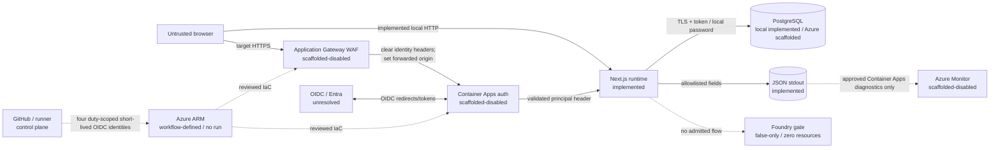

# Threat model

- **Review state:** Foundation baseline
- **Last architecture alignment:** 2026-07-26
- **Production state:** Not configured or deployed

This model covers the implemented local runtime and the scaffolded-disabled Azure target. It does
not authorize a product data flow. The [constitution](../../CONSTITUTION.md),
[classification](DATA_CLASSIFICATION.md), [residency matrix](DATA_RESIDENCY.md), and
[logging contract](LOGGING_AND_TELEMETRY.md) are binding inputs.

## Scope

### In scope

- Browser, Next.js pages, raw probes, oRPC v1 health API, environment parsing, UI theme storage
- Container Apps principal-header normalization
- PostgreSQL pool/token/migration boundaries
- Structured JSON stdout and explicitly disabled application trace export
- Source, dependencies, CI/build/image delivery
- Scaffolded Application Gateway, internal Container Apps, ACR, Key Vault, PostgreSQL, monitoring,
  private networking, identities, and migration job
- The false-only, zero-resource Foundry admission boundary

### Out of scope because absent

- Product routes, entities, records, roles, permissions, user management, files, analytics
- A deployed Azure environment or approved production identity/provider
- A Foundry model, deployment, agent, prompt, tool, dataset, trace, evaluation, or live call
- Multi-region failover and production disaster recovery

The first PRD that adds any absent flow must extend this model before implementation.

## Assets

| Asset                                                  | Classification                          | Security objective                                                |
| ------------------------------------------------------ | --------------------------------------- | ----------------------------------------------------------------- |
| Source, lockfile, IaC, workflows, release inputs       | Internal; security details Confidential | Integrity, reviewability, reproducibility                         |
| OIDC/managed-identity/database tokens and secrets      | Restricted                              | Confidentiality, short lifetime, intended audience, no logging    |
| TLS private key and OIDC client credential             | Restricted                              | Key Vault custody, rotation, least privilege                      |
| Identity claims and tenant/object/resource identifiers | Confidential                            | Minimize, validate issuer/audience, no accidental disclosure      |
| Future customer/application data                       | Restricted until classified             | Purpose limitation, authorization, residency, integrity, deletion |
| Database schema and migration history                  | Confidential                            | Integrity, forward compatibility, recoverability                  |
| Container images and dependency graph                  | Internal                                | Provenance, immutability, vulnerability response                  |
| Runtime/diagnostic telemetry                           | Internal to Restricted by field         | Availability evidence without payload/credential leakage          |
| DNS, network, and deployment configuration             | Confidential                            | Integrity, controlled change, no drift                            |

## Actors

- Unauthenticated internet client
- Authenticated but unauthorized or compromised user
- Malicious script/dependency or compromised build input
- Authorized developer/reviewer/operator making an error
- Compromised GitHub account, workflow, runner, or federated identity
- Compromised application or migration managed identity
- External identity/DNS/package/cloud service and authorized support personnel
- Future hostile document, prompt, tool result, or model output (currently no flow)

## Data flow and trust boundaries

Nodes labeled scaffolded-disabled do not exist in a deployed environment.

Primary boundaries:

1. Internet to regional ingress
2. Gateway to internal Container Apps
3. Platform authentication to application authorization
4. HTTP/contracts to server implementation
5. Runtime/job to PostgreSQL and Azure services
6. Runtime/platform to telemetry
7. GitHub/operator to Azure management plane
8. Future application to Foundry/external tools

## Existing safeguards and limitations

### Implemented

- Strict Zod validation for environment, contracts, errors, correlation IDs, and principal headers
- Safe response envelopes and no stack/infrastructure disclosure
- No-store/nosniff API response headers and broader Next.js browser headers
- Allowlisted structured logging with prohibited-field redaction tests
- Explicit local versus `azure-managed-identity` database modes and refreshable Entra token callback
- Bundled production migration entrypoint with one same-session PostgreSQL advisory lock
- Empty database schema; no production/customer seed data
- Exact stable dependencies, strict TypeScript, package exports, and deterministic checks
- Report-only CSP and reduced-motion/focus/token enforcement; theme changes avoid transient color
  transitions and recheck contrast
- Fail-closed same-change PRD coverage for functional source/config/IaC/workflow/Copilot paths,
  deletions, and both sides of renames
- Staged delivery definition with sealed source/config/image evidence, digest-only promotion,
  migration before traffic, same-run reviewed/fresh what-if equality, four OIDC duties, candidate
  isolation, acceptance, and verified rollback

### Scaffolded-disabled

- Regional WAF, backend TLS/SNI validation, internal environment, app IP restriction
- Gateway overwrite/clearing of forwarded and identity headers
- Built-in OIDC authentication and Key Vault secret reference
- Private endpoints/DNS, public data-plane denial, managed identities, least-privilege Azure RBAC
- Entra-only PostgreSQL, HA/backup parameters, distinct migration job identity
- Regional private Log Analytics routing, diagnostics, query RBAC, Application Insights/AMPLS
- Azure Firewall egress mode
- False-only Foundry marker with no resources, DNS, RBAC, data plane, model, or agent

These controls have not been deployed or penetration-tested.

## Threats, controls, and open actions

| ID    | Threat                                                     | Affected boundary / impact                              | Current mitigation                                                                                                                                                                          | Residual gap / required action                                                                                                                                                |
| ----- | ---------------------------------------------------------- | ------------------------------------------------------- | ------------------------------------------------------------------------------------------------------------------------------------------------------------------------------------------- | ----------------------------------------------------------------------------------------------------------------------------------------------------------------------------- |
| TM-01 | Forged `X-MS-CLIENT-PRINCIPAL*` headers                    | Spoofing identity and privilege                         | Parser rejects malformed content; gateway Bicep clears client headers; app ingress is intended to accept only gateway subnet                                                                | Parser alone cannot establish trust. Deploy and manually prove gateway overwrite, direct-ingress denial, auth injection order, issuer/audience, and app authorization         |
| TM-02 | Authentication confused with authorization                 | Authenticated user performs unapproved action           | Architecture assigns authorization to the app and no product action exists                                                                                                                  | Every future contract needs explicit server-side deny-by-default policy and tests; no roles are currently defined                                                             |
| TM-03 | OIDC issuer/audience/callback mix-up or open redirect      | Account confusion, token theft, redirect abuse          | Preflight requires HTTPS issuer, tenant-specific Entra issuer, audience, public callback host, allowlist, and forwarded-host approval; token store off                                      | Audience/provider undecided; validate callback/logout paths, nonce/cookie behavior, allowed redirect semantics, and External ID/provider terms in a deployed test             |
| TM-04 | Direct backend/WAF bypass                                  | Requests evade TLS/WAF/header rewrite                   | Internal Container Apps environment, disabled public access, app IP restriction to gateway subnet modeled                                                                                   | Not deployed; verify platform source ranges and ensure no alternate FQDN/ingress path bypasses restriction                                                                    |
| TM-05 | TLS/DNS compromise                                         | Interception or routing to attacker                     | HSTS, gateway TLS, Key Vault certificate reference, backend chain/SNI validation, DNS/TLS preflight                                                                                         | Domain/CA/key lifecycle absent; approve DNSSEC/account security, issuance/bootstrap, rotation, revocation, and backend trust                                                  |
| TM-06 | XSS/content injection                                      | Browser code execution, token/action abuse              | React escaping, semantic shell, enforced browser headers, report-only restrictive CSP                                                                                                       | CSP still allows inline script/style and has no collector. Add nonces, safe reporting, route coverage, and enforce before production                                          |
| TM-07 | CSRF/clickjacking/cross-origin abuse                       | Unauthorized state change                               | Frame denial, Same-Origin opener/resource policies; no state-changing product action exists                                                                                                 | Built-in auth cookie and future mutation routes need SameSite verification, origin/CSRF strategy, and CORS contract                                                           |
| TM-08 | Contract/input abuse and unsafe error detail               | Injection, denial, information disclosure               | oRPC/Zod contract, bounded schemas, safe envelopes, generic catches, WAF/request limits scaffold                                                                                            | Add operation-specific size/complexity/rate limits and authorization for each PRD; WAF is not validation                                                                      |
| TM-09 | Correlation-ID poisoning/cardinality                       | Log injection, cross-user linkage, cost                 | Only UUID accepted; invalid input replaced; field is opaque and bounded                                                                                                                     | Do not use it as identity; add request-rate/cardinality monitoring without client/user dimensions                                                                             |
| TM-10 | Secret, body, personal data, SQL, or model content in logs | Confidentiality/residency breach                        | Fixed events/fields, schema strip, Pino redaction, no error object/body at current call sites                                                                                               | Review platform diagnostics and every exporter; enforce safe CI/browser/CSP/migration logs and retention                                                                      |
| TM-11 | Unsafe telemetry destination or public fallback            | Exfiltration/cross-region processing                    | Runtime exporter fails closed; PII-safe JSON stdout targets approved regional Log Analytics through Container Apps routing; public ingestion/query and AMPLS modes are private-only         | Resources are undeployed. Approve category schemas/destination/DNS/retention/query FIC/RBAC and AMPLS exception; no Application Insights connection string/export is admitted |
| TM-12 | Static/stale database credential theft                     | Database takeover                                       | Production password mode rejected; managed identity uses explicit credential and refreshable token; TLS validation                                                                          | Verify token audience, identity assignment, host trust, token leakage resistance, and emergency revoke in Azure                                                               |
| TM-13 | Overprivileged or missing PostgreSQL principal             | Tampering/availability failure                          | Distinct app/migration identities and bootstrap runbook                                                                                                                                     | ARM cannot create SQL principals. Create OID-bound principals, narrow grants/default privileges, and automated positive/negative verification                                 |
| TM-14 | SQL injection or unauthorized row access                   | Data disclosure/tampering                               | No product query exists; driver supports parameterized queries                                                                                                                              | First persistence PRD must define data access, parameterization, tenant/record authorization, tests, and Restricted data handling                                             |
| TM-15 | Unsafe/destructive or concurrent migration                 | Outage, corruption, unrecoverable rollback              | Bundled managed-identity entrypoint runs only in the manual digest-pinned job; same `PoolClient` holds the advisory lock for Drizzle; rollout requires success evidence                     | Review generated SQL, statement/lock timeouts, backfill/invariants, grants, compatibility, and restore evidence before each persistence change                                |
| TM-16 | Database outage or cross-region restore                    | Availability/residency violation                        | Readiness fails closed; HA/backup/replica preflight                                                                                                                                         | RPO/RTO, approved zones/geography, backup copy location, restore drill, and regional failure decision unresolved                                                              |
| TM-17 | SSRF or compromised runtime egress                         | Data/token exfiltration, internal scanning              | No product fetch exists; firewall subnet/mode and FQDN allowlist modeled; preflight requires controlled egress                                                                              | Firewall disabled in fixture; inventory Azure platform/OIDC/registry/telemetry endpoints, private DNS, DNS proxy, and deny tests                                              |
| TM-18 | Managed identity misuse / lateral movement                 | Access to Key Vault, ACR, or database                   | Distinct app/migration/gateway identities and narrow resource roles modeled; no broad Owner                                                                                                 | Validate exact management/data-plane grants, identity lifecycle, token scope, PostgreSQL mapping, and incident revocation                                                     |
| TM-19 | Supply-chain compromise                                    | Malicious dependency/image/action/code                  | Exact stable pins, lockfile audit, strict peers, SHA-pinned workflow definitions, CodeQL workflow, and digest-pinned non-root standalone image                                              | No hosted scan evidence exists; approve SCA/image policy, provenance/SBOM/signing, action review and base-image update/patch process                                          |
| TM-20 | Compromised GitHub workflow/OIDC subject                   | Unauthorized Azure changes                              | Four distinct client IDs, protected config digest, tokenless acceptance, job-scoped OIDC, private-runner jobs, sealed evidence, stage policy, and same-run reviewed/fresh what-if equality  | No run or external environment/FIC/RBAC/runner proof exists. Constrain subjects/roles, protect labels/branch/environment, isolate/clean runners, audit and revoke             |
| TM-21 | Private ACR inaccessible or bypassed with public access    | Delivery outage or weakened network                     | Public ACR disabled; registry duty is separate; workflow verifies private resolution, pullback image ID, digest, and locked tag/manifest                                                    | Runner is not provisioned/proved. Approve patching, isolation, cleanup, logging, DNS and egress; never enable public ACR as a workaround                                      |
| TM-22 | IaC/state drift or malicious parameter                     | Hidden public access, region/identity changes           | Incomplete production fixture, deep placeholder/public-access preflight, sanitized what-if review, fresh-state digest equality before mutation, and no-portal-drift rule                    | External Azure Policy/drift alerts, reviewer behavior, production config custody, and post-run read-only evidence remain unproved                                             |
| TM-23 | WAF/resource exhaustion                                    | Cost or availability attack                             | WAF prevention/request limits, autoscale, bounded probes/timeouts modeled                                                                                                                   | Approve DDoS tier/inheritance, rate limits, budgets/alerts, load tests, quotas, and fail-safe scaling                                                                         |
| TM-24 | Key Vault deletion/certificate expiry                      | Auth/ingress outage or secret loss                      | RBAC, soft delete, purge protection, private access modeled                                                                                                                                 | Bootstrap sequence, paired-region residency, renewal/expiry alert, version rollout, recovery drill, and break-glass unresolved                                                |
| TM-25 | Misleading health endpoint                                 | Sensitive disclosure or false availability              | Liveness only checks process; readiness emits only status/ID and checks config/database when enabled                                                                                        | Define dependency set/SLO, probe load and startup behavior; keep endpoints unauthenticated but non-sensitive                                                                  |
| TM-26 | In-memory state or cache inconsistency across replicas     | Session loss, stale/unauthorized data                   | Architecture prohibits session/app state, ISR, and shared-cache assumptions                                                                                                                 | Review every future cache/session addition as a store/trust/residency boundary                                                                                                |
| TM-27 | Foundry prompt injection/tool exfiltration                 | Future data/action compromise                           | No flow or infrastructure; false-only module emits zero resources and preflight rejects enablement/model declarations                                                                       | A future PRD/new deployable design must threat-model prompts/files/tool outputs, authorization, egress, human approval, rendering, and evaluations                            |
| TM-28 | Foundry retention/safety monitoring surprises              | Restricted data retained or processed elsewhere         | No account, store, model, agent, content setting, trace, or invocation exists                                                                                                               | Future admission must approve terms, abuse/content monitoring, state/stores/traces/evaluations and deletion; no zero-retention inference                                      |
| TM-29 | Nonregional control-plane/support exposure                 | Residency/legal breach                                  | Residency matrix lists GitHub, Entra, ARM, DNS, registries, AMPLS, Key Vault resiliency and support                                                                                         | Obtain contractual/tenant/service approvals and minimize metadata/support attachments                                                                                         |
| TM-30 | Malicious/real data in local or CI tests                   | Unauthorized copies and artifact leakage                | Foundation uses synthetic deterministic tests; no product dataset exists                                                                                                                    | Keep production data prohibited, bound artifact retention, sanitize failures, and govern any future test-data generation                                                      |
| TM-31 | Synthetic placeholder accepted as production               | Wrong tenant/region/host, unsafe or unmonitored service | Preflight rejects test/example markers, placeholder domains, low-entropy UUIDs/SHAs, unresolved SKUs/identities, public planes, wrong migration command, Foundry, and incomplete monitoring | Preflight cannot prove ownership, provider state, contracts, or human approval; retain protected configuration review and separately authorized read-only evidence            |
| TM-32 | Failed candidate leaves unsafe traffic posture             | Outage, auth bypass, unintended exposure                | Prior revision stays at 100% while staging; first bootstrap is deny-all; activation traps failures and verifies restored traffic/exposure plus prior health/auth                            | Nontraffic IaC remains after rollback and needs operator review; inability to prove recovery is an immediate incident                                                         |

## Abuse cases for future product work

Before adding product behavior, explicitly test:

- enumeration through status, timing, error, search, or pagination differences;
- broken object/tenant authorization and confused-deputy calls;
- mass assignment, duplicate/replayed mutations, concurrency and idempotency failures;
- oversized/decompression/parser inputs and resource exhaustion;
- stored/reflected content injection and unsafe URL fetch/redirect;
- privilege changes hidden only in UI;
- deletion that leaves indexes, logs, caches, backups, exports, or derived data;
- support/admin access without purpose, approval, or audit.

## Security verification gates

### Deterministic/offline

- `pnpm lint`
- `pnpm typecheck`
- `pnpm test:unit`
- `pnpm spec:validate:all`
- `pnpm infra:validate`
- `pnpm build`
- root-context container build when the Docker surface changes

### Environment-dependent

- PostgreSQL integration and migration tests against disposable local data
- Playwright/axe plus keyboard, zoom, post-theme-switch contrast, reduced-motion, and CSP review
- protected Azure what-if after production/monitoring preflight; same-run fresh state must match the
  reviewed artifact before each mutation
- private DNS/public-denial/backend TLS/header/OIDC/managed-identity/grant verification
- image scan/provenance, digest-only promotion, migration-before-traffic, safe Log Analytics
  initialization evidence, and rollback recovery verification
- backup restore and recovery exercises before production authorization

No live Foundry/model call belongs in foundation validation.

## Assumptions that must be proved

- The Application Gateway is the only reachable app ingress.
- Gateway header clearing happens before Container Apps auth injects trusted headers.
- The public host/scheme is preserved for provider callbacks and logout.
- Every Azure data plane denies public access and private DNS resolves from each workload/runner.
- Managed identities map to the intended Entra and PostgreSQL principals with no extra roles.
- Four external delivery FICs/RBAC scopes enforce their distinct duties and every Azure job uses the
  approved private runner.
- Diagnostic categories contain only approved fields and JSON stdout reaches only the regional
  private Log Analytics workspace; Application Insights receives no application export.
- Service-managed backup/replication/support locations fit the permitted geography.
- A prior image can run against the expanded schema during rollback.
- A failed activation restores and proves the prior traffic/exposure/health/auth posture, or first
  bootstrap remains unreachable.

Until proved, each assumption is a production blocker.

## Update triggers

Update this model with any new route, contract, claim, permission, store/table, external call,
upload, telemetry field/export, cache, background job, infrastructure/network path, identity/role,
deployment mechanism, backup/replica, Foundry feature, or recovery assumption. Link findings to the
governing PRD and acceptance evidence.
